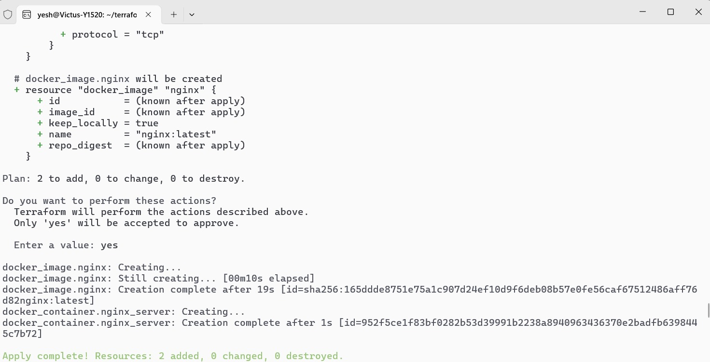
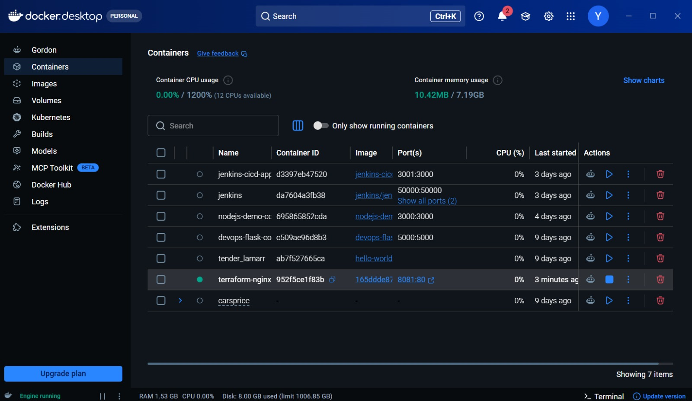
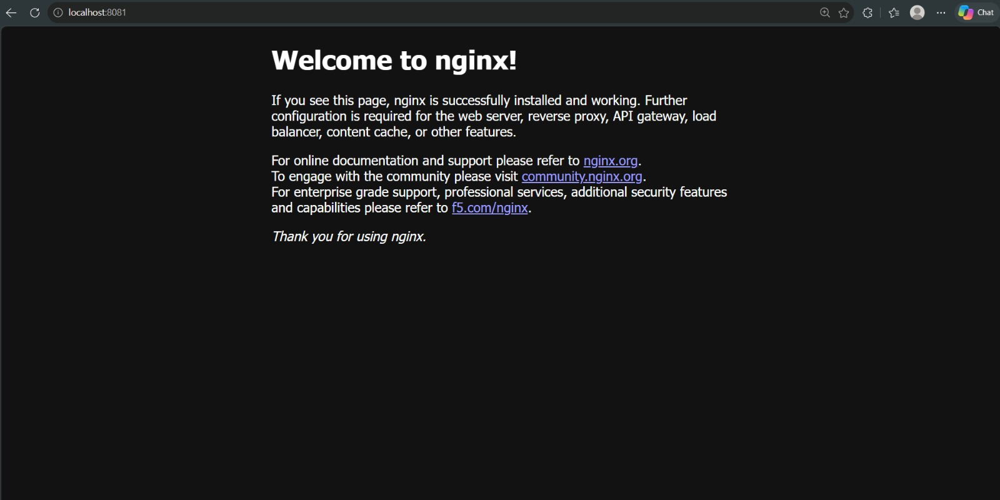
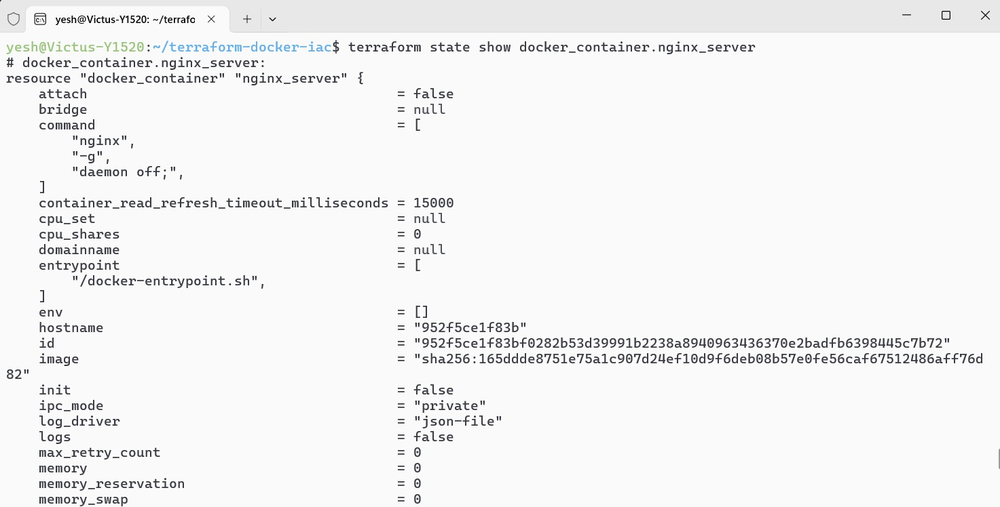
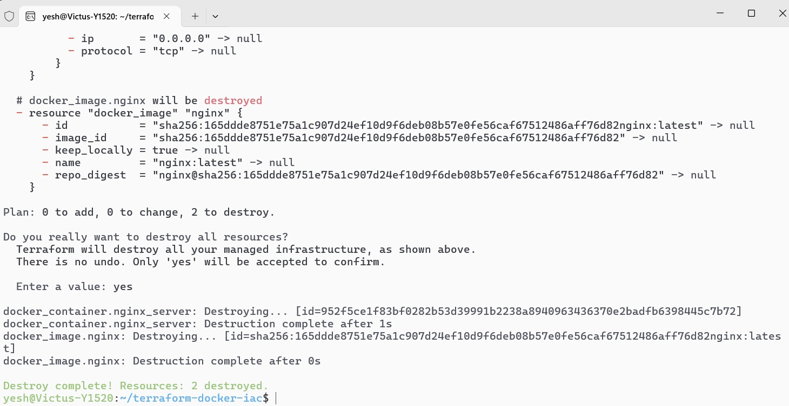

# Infrastructure as Code (IaC) with Terraform and Docker

## Project Overview
This project demonstrates Infrastructure as Code (IaC) using Terraform and Docker. Terraform is used to automatically download an Nginx image and provision a Docker container.

The Nginx server is accessible at `http://localhost:8081`.

## Technologies Used
- Terraform
- Docker
- Nginx
- Ubuntu 24.04 (WSL)

## Project Structure
```text
terraform-docker-iac/
├── main.tf
├── README.md
├── .gitignore
├── .terraform.lock.hcl
└── screenshots/
```

## Implementation

1. **Initialize Terraform**
   ```bash
   terraform init
   ```
2. **Format and validate**
   ```bash
   terraform fmt
   terraform validate
   ```
3. **Preview infrastructure**
   ```bash
   terraform plan
   ```
4. **Create Docker resources**
   ```bash
   terraform apply
   ```
5. **Verify the container**
   ```bash
   docker ps
   ```
6. **Inspect Terraform state**
   ```bash
   terraform state list
   terraform state show docker_container.nginx_server
   ```
7. **Destroy resources**
   ```bash
   terraform destroy
   ```

## Configuration Details
- Docker image: `nginx:latest`
- Container name: `terraform-nginx`
- Container port: `80`
- Host port: `8081`

## Screenshots

**Terraform Apply**



**Docker Container**



**Nginx Welcome Page**



**Terraform State**



**Terraform Destroy**



## Learning Outcomes
- Understanding Infrastructure as Code.
- Using Terraform providers and resources.
- Provisioning Docker containers automatically.
- Understanding Terraform plan, apply, state, and destroy commands.

## Author
Yeshwanth V
